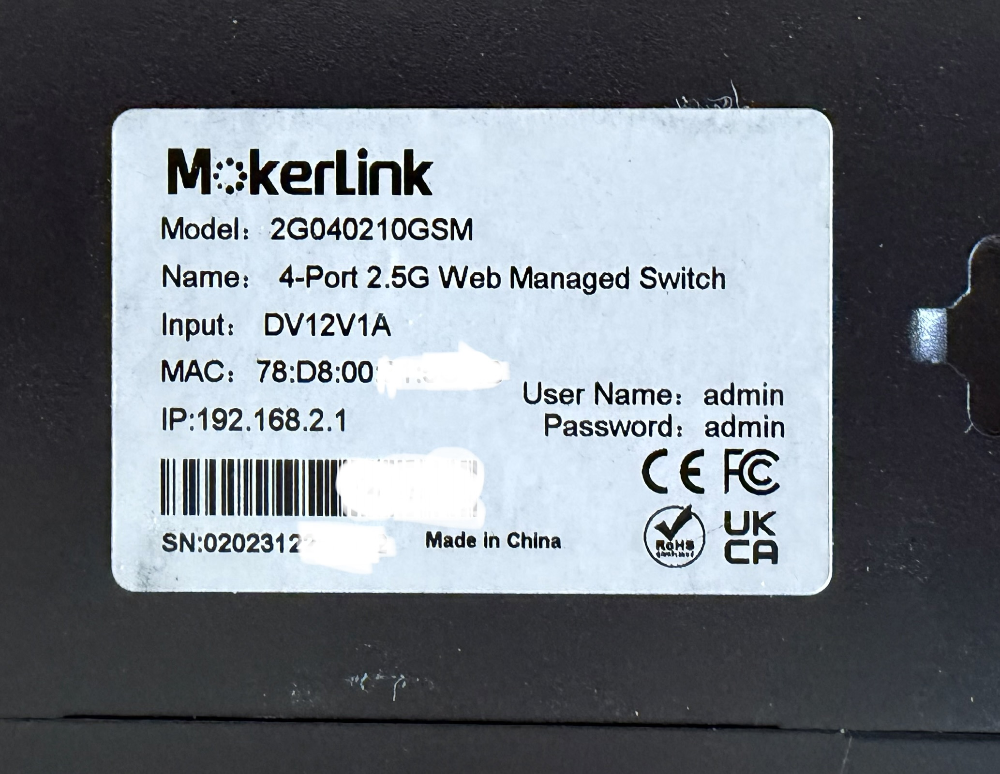
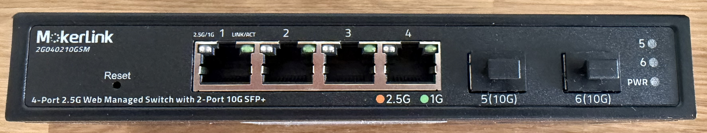
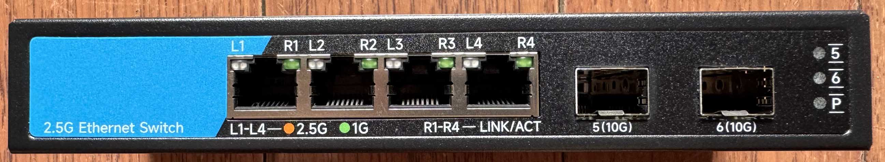
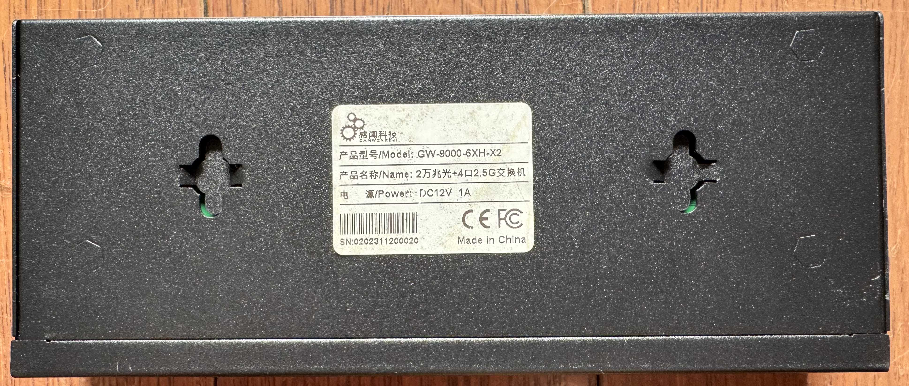
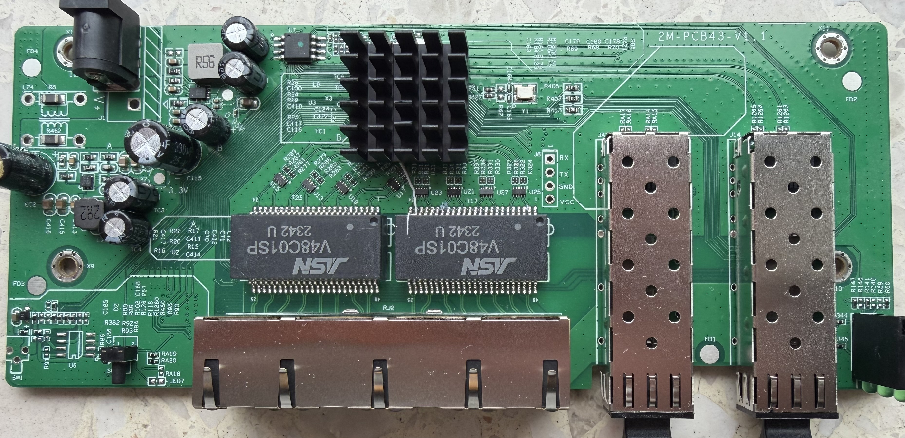
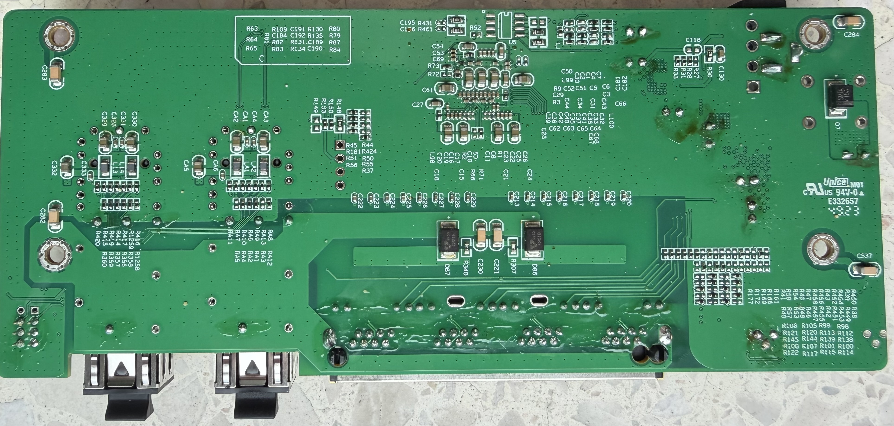
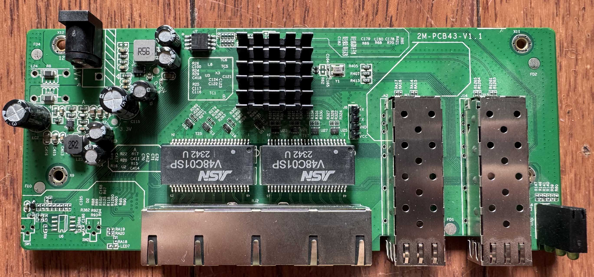
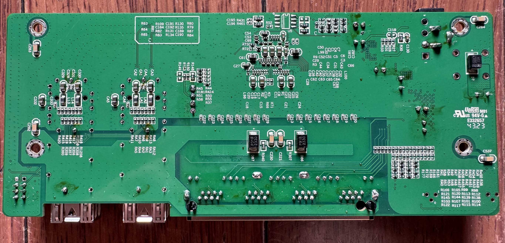

# 2G040210GSM / GW-9000-6XH-X2

The following is a documentation for the managed switch marked as `2G040210GSM`
and sold by Mokerlink, and for the unmanaged `GW-9000-6XH-X2` sold by Ganwen.
Both carry the `2M-PCB43-V1.1` marking and are electrically identical; they
differ only in the fitted flash chip. The PCB revision defines the wiring, see
[2M-PCB43-V2.1](2M-PCB43-V2.1.md) for the other revisions.

## Variants

| Device | Flash | Machine target |
| --- | --- | --- |
| MokerLink `2G040210GSM` (web-managed) | 2 MB | `MACHINE_KP_9000_6XHML_X2_V1_1` |
| Ganwen `GW-9000-6XH-X2` (unmanaged) | 4 MB Winbond `W25Q32JVSIQ` (JEDEC `EF 40 16`) | `MACHINE_GW_9000_6XH_X2_V1_1` |

Both targets resolve to the same board definition: `machine/GW_9000_6XH_X2_V1_1.c`
is a symlink to `machine/pcb/2M_PCB43_V1_1.c`, so port order, SFP slots and LEDs
are identical. The two images differ only in the model string and the CRC16.

### Label specifications

- **Name**: 4-port 2.5G Web Managed Switch
- **Ports**:
  - 4 × RJ45: 10/100/1000/2500 Mbps
  - 2 × SFP+: 1000 / 2500 / 10000 Mbps
- **Power**: 12V DC, 1A barrel connector 

### What works
The device is fully supported:
- All 4 2.5GBASE-T RJ45 ports work at 10/100/1000/2500 Mbps
- The SFP+ port supports 1G, 2.5G and 10G modules 
- LEDs work with the same indiciations as the OEM firmware (build with `make MACHINE=MOKERLINK_2G040210GSM` if building yourself, or use the corresponding pre-compiled binary)
- untested due to missing Hardware: SFP+ ports equipped with 1G or 2.5G SFPs.

Verified on the Ganwen `GW-9000-6XH-X2` variant (build with
`make MACHINE=GW_9000_6XH_X2_V1_1`): all four 2.5GBASE-T RJ45 ports in the right
order, both SFP+ slots with 10G modules (Finisar `FCBG110SD1C05-1RA`), LEDs, the
web interface and configuration stored in flash.

### Hardware overview
Front

Label

#### Ganwen GW-9000-6XH-X2

Front side (copper `L`/`R` LED pairs, SFP `5`/`6` and the `P` power LED):

Label:

### Flash

Both variants are flashed the same way. Note the different flash size: the
Ganwen board is fitted with a **4 MB Winbond `W25Q32JVSIQ`** (JEDEC `EF 40 16`)
instead of the 2 MB part, while RTLPlayground only uses the first 1 MB
(`FIRMWARE_UPLOAD_START` is `0x80000`). The region above the firmware image keeps
whatever the stock firmware left there, so **erase the whole chip when flashing**;
a leftover that starts with `00 40` at `0x80000` is taken for a staged update
image. No other flash setting differs, in particular no single-IO mode is needed.

### PCB overview

**Board markings**
- Top silkscreen: 2M-PCB43-V1.1

Top side

Bottom

Ganwen `GW-9000-6XH-X2`, top and bottom, same `2M-PCB43-V1.1` marking:

### J1, serial console

| `J8` pin | Signal      |
| -------- | ----------- |
| 1        | RX (Input)  |
| 2        | TX (Output) |
| 3        | GND         |
| 4        | 3V3         |

## Power supply

Input power is delivered via barell plug, `12V 1A` adapter was provided.
