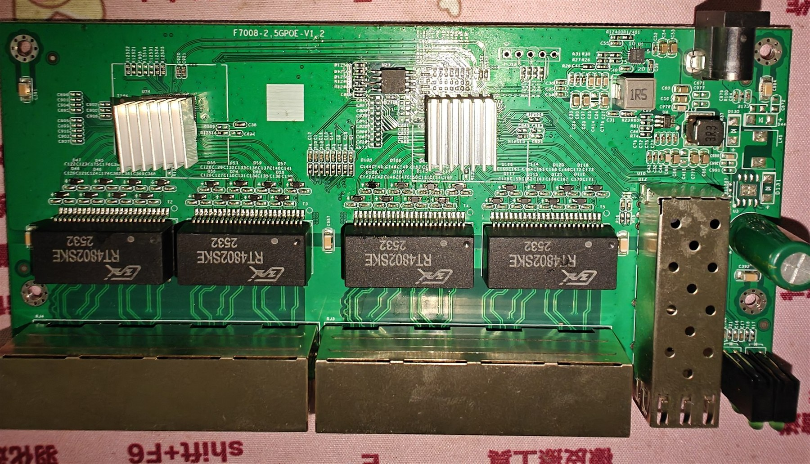
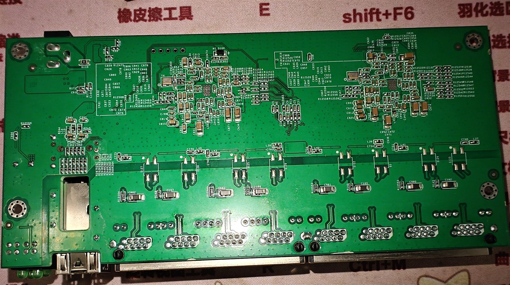

# F7008-2.5

Documentation for the unmanaged 8 + 1 switch sold as `7018-2.5G` by Guangnianwei
(光年微), board marking `F7008-2.5`, PCB `F7008-2.5GPOE-V1.2`.

### Brands

| Brand | Type | Managed | PCB | Flash | Chip RTL |
|-------|------|---------|-----|-------|----------|
| Guangnianwei (光年微) | 7018-2.5G | No | F7008-2.5GPOE-V1.2 | W25Q64JVSSIQ (8 MB) | 8373N + 8224N |
| NPA | AP-7018-2.5G | No | F7008-2.5GPOE-V1.2 | P25Q40SU (512 kB) | 8373N + 8224N |

Both brands are the same board with the same pin map; they differ in the brand
print and in the flash chip. On the 512 kB `P25Q40SU` the image fills the chip
exactly, so a web update does not fit and the firmware has to be written with a
clamp.

### What works

- All eight 2.5GBASE-T RJ45 ports at 10/100/1000/2500 Mbps
- SFP+ port with 1G/2.5G/10G modules
- LEDs of the eight RJ45 ports and the front panel SFP lamps

### Not verified

- The SFP lamps hang off pads that the unmanaged firmware leaves unassigned.
  Only pad 27, the `9(10G)` lamp, was identified; the `SFP` lamp works, but its
  pad is still unknown.
- The UART header footprint is present but unpopulated, and no boot log could be
  captured from it, so the baud rate is unknown. There are most likely
  unpopulated 0-Ohm resistors next to the header; bridging those should bring
  the console to life.

### Build targets

```
make MACHINE=GUANGNIANWEI_7018_2_5G
make MACHINE=NPA_AP_7018_2_5G
```

Both select the same `machine/pcb/F7008_2_5GPOE_V1_2.c`; they differ only in the
model string the UI shows.

### LED wiring

Measured pad to lamp map (`led_mux` index -> lamp):

| Port | green lamp | yellow lamp |
|------|-----------|-------------|
| 1 | pad 0  | pad 1  |
| 2 | pad 2  | pad 3  |
| 3 | pad 4  | pad 5  |
| 4 | pad 6  | pad 8  |
| 5 | pad 9  | pad 10 |
| 6 | pad 12 | pad 15 |
| 7 | pad 18 | pad 21 |
| 8 | pad 24 | pad 25 |

Pads 7, 11, 13, 14, 16, 17, 19, 20, 22, 23 and 26 do not drive an RJ45 lamp.

The front panel is silkscreened `2.5G: Green / 1000/100M: Yellow`, and the target
follows it: the green lamp is on while the port is linked at 2.5G, the yellow
lamp blinks while data is flowing.

The SFP lamps are not part of this table. Pad 27 drives the front panel
`9(10G)` lamp: it is switched to LED use by `.high_leds.mux`, and `LED_27` also
has to be set in `.high_leds.enable`, otherwise the pad stays dark whatever the
pad table says.

### Front panel lamps

The case has a 2x2 block of lamps next to the SFP cage. Measured on an NPA
`AP-7018-2.5G` unit:

| Lamp | Behaviour |
|------|-----------|
| top left | power, lit as soon as the board is powered |
| top right | system LED, driven through `RTL837X_REG_LED_MODE`; steady once the firmware has booted |
| bottom left | SFP lamp: lit while a module is fitted and the SerDes link is up, and blinking with traffic |
| bottom right | `GPIO29`, i.e. `GLB_RLDP_LED_EN`: the loop-detection lamp |

`set_sys_led_state()` only reaches the status lamp when pad 28 is switched to the
LED engine, which needs `LED_28_SYS` in `.high_leds.mux` - without it the pad
stays a GPIO and the lamp is dark once the boot sequence is over. The target sets
that bit; what the lamp then does is the firmware's stock behaviour: `leds_setup()`
selects the slow mode, so the lamp blinks while the board boots, and the end of
the boot sequence switches it to a steady light. Getting a heartbeat instead
would mean not calling `set_sys_led_state(SYS_LED_ON)` at the end of the boot
sequence, which is shared code, so this board keeps the steady light.

The SFP lamp is pad 24, the green LED of port 8 (LED id 28). It uses entry 0 of
the SFP port's LED set (`SET1`), which originally had `LINK` only, so traffic did
not show; the entry now carries `LINK | ACT`. That this is the lamp of entry 0 is
what identifies the pad: adding `ACT` there made the front panel lamp blink with
traffic, and entry 0 is the pad the mux table below gives for port 8 green.
Entry 1 (pad 25, the yellow lamp of the same port) has no lamp on this case.

The bottom right lamp follows `GPIO29` directly: driving that pad as a plain
GPIO (clearing `PIN_MUX_0` bit 29 and `LED_GLB_IO_EN` bit 29) blinks it, which
is how it was identified. The other three are not switchable that way: with the
pad taken over as GPIO the lamp stays dark, so they are driven by the LED engine
- the two 3 mm LEDs soldered at the board edge are `LED3` and `LED4` on the
silkscreen.

The SFP lamp therefore needs no extra machine setting: it is pad 24, already in
the `led_mux` table above, and it follows the port 8 LED set. It cannot be found
with the GPIO walk, because taking the pad away from the LED engine is exactly
what turns it off.

### PCB overview

The board is marked `F7008-2.5GPOE-V1.2`.

Top side:



Bottom side:



### Hardware notes

- 4 x `RT4802SNE` magnetics
- Unpopulated UART header footprint, next to the magnetics
- Power input 12V 1A, 180 x 84 x 29 mm metal case
