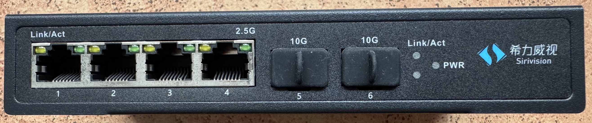
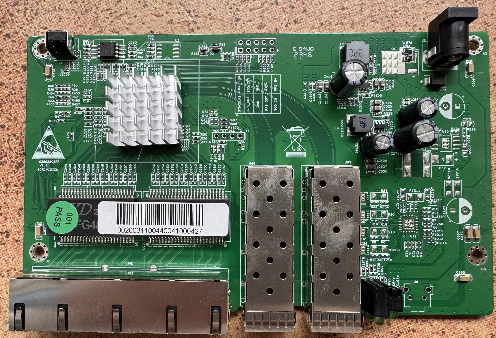
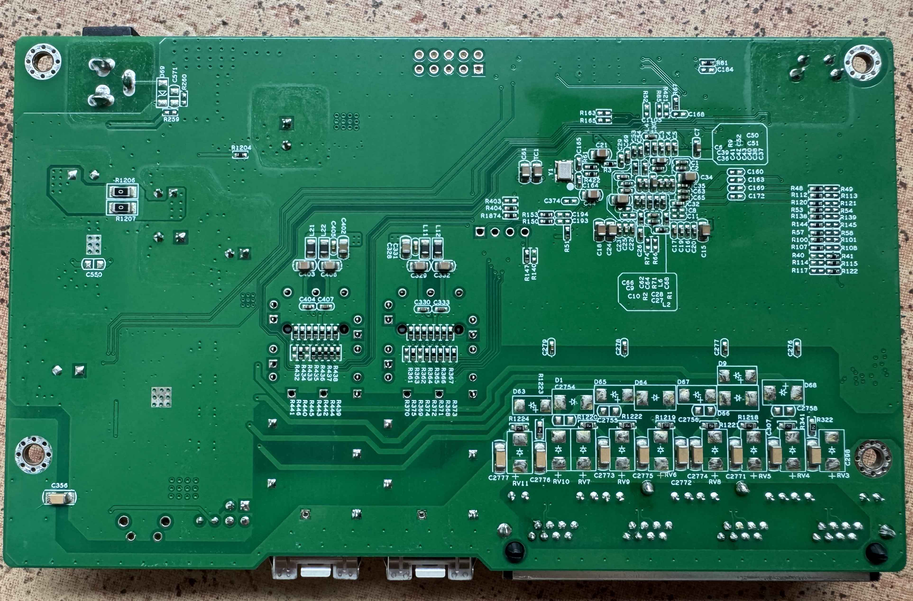
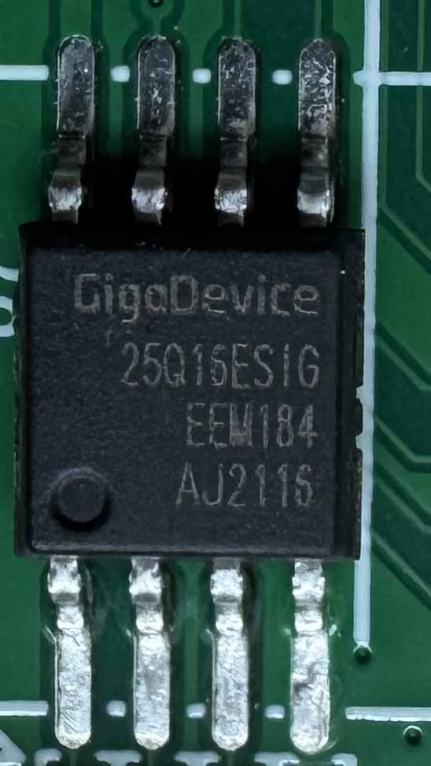
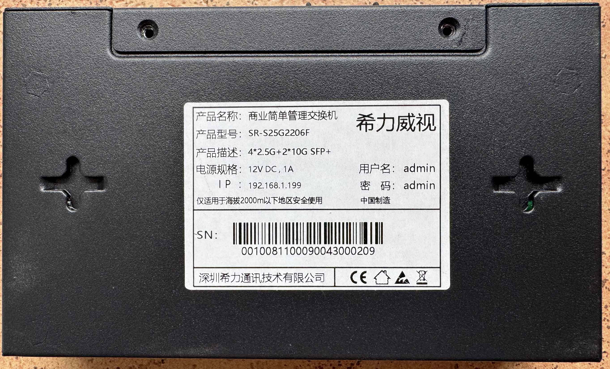

# SIRIVISION S25G2206FP V1.1

RTL8372 (non-N) with 4 × 2.5G RJ45 and 2 × SFP+, 2 MB flash.  The PCB
silkscreen is `S25G2206FP V1.1`, with the `SIRIVISION` vendor mark printed
separately.  Two products are known on this board; they differ only in the
RJ45 LED set:

## Brands

| Brand | Type | Managed | PCB | Flash | Chip RTL |
|---|---|---|---|---|---|
| YuanLey | YS25-0402M | Yes | S25G2206FP V1.1 | 2M | 8372 |
| Sirivision | SR-S25G2206F | Yes | S25G2206FP V1.1 | 2M | 8372 |

The `FP` in the PCB name belongs to the PoE variant; the SR-S25G2206F is
non-PoE.  The YuanLey YS25-0402M was the first verified sample; the
Sirivision unit uses the same base wiring and only changes the RJ45 LED
conditions (see [LEDs](#leds) below).

## Label specifications

Sirivision SR-S25G2206F:

| Item | Value |
|------|-------|
| Model | SR-S25G2206F |
| Ports | 4 × RJ45 10/100/1000/2500 Mbps, 2 × SFP+ 1G/2.5G/10G |
| Power input | 12 V DC, 1 A, 5.5/2.5 mm barrel |
| PoE | No |
| Managed | Yes (web) |
| Stock defaults | IP 192.168.1.199, user `admin`, password `admin` |

The YuanLey label was not recorded; the port and power ratings are
identical.

## CPU, PHY and flash

| Part | Identification |
|------|----------------|
| SoC | RTL8372 (non-N) |
| PHY | not recorded (under the heatsink) |
| Flash | GigaDevice 25Q16ESIG (GD25Q16ESIG), 2 MB (Sirivision sample) |
| Factory MAC | flash offset `0x1FC000` |

## Build

```
make MACHINE=YUANLEY_YS25_0402M        # YuanLey YS25-0402M
make MACHINE=SIRIVISION_SR_S25G2206F   # Sirivision SR-S25G2206F
```

Both targets share the `machine/pcb/S25G2206FP_V1_1.c` base definition; the
Sirivision one uses `machine/pcb/S25G2206FP_V1_1_SIRIVISION.c`, which only
changes the RJ45 LED set.

## Port mapping

| Front port | ASIC MAC | Interface |
|------------|----------|-----------|
| 1–4 | 4–7 (logical) | RJ45 2.5G |
| 5 | 8 (logical) | SFP+ (SDS1, left cage) |
| 6 | 3 (logical) | SFP+ (SDS0, right cage) |

## Board signals

| Function | GPIO |
|----------|------|
| SFP detect, left cage (J4) | 30, low with a module inserted |
| SFP LOS, left cage | 37, high without light |
| SFP detect, right cage (J2) | 50 |
| SFP LOS, right cage | 51 |
| SFP TX disable | not connected, `GPIO_NA` |
| SFP I2C, left | SDA 39 / SCL 40, `I2CBUS(GPIO39_I2C_SDA4, GPIO40_I2C_SCL3_MDC1)` |
| SFP I2C, right | SDA 41 / SCL 40, `I2CBUS(GPIO41_I2C_SDA3_MDIO1, GPIO40_I2C_SCL3_MDC1)` |
| Reset button | 36 |

## LEDs

Both variants have two LEDs per RJ45 port and one LED set for the SFP
section.  The difference is in LED set 0:

- `YUANLEY_YS25_0402M`: function 0 = link/activity (1G/100M/10M), function 2 =
  2.5G link/activity; this is the LED set verified on the YuanLey sample.
- `SIRIVISION_SR_S25G2206F`: function 0 = link/activity at all speeds including
  2.5G, function 2 = 2.5G link only.

On the Sirivision front panel the left RJ45 LED is labelled `Link/Act` and
the right one `2.5G`; the SFP cages are labelled `10G` and the SFP section
has a single `Link/Act` LED plus `PWR`.

## What works

YuanLey YS25-0402M:

- all 2.5GBASE-T RJ45 ports at 10/100/1000/2500 Mbps
- both SFP+ ports with 1G, 2.5G and 10G modules
- LEDs with the same indications as the OEM firmware

Sirivision SR-S25G2206F (verified on this unit):

- port mapping
- left yellow link/activity and right green 2.5G link
- web upgrade from an older RTLPlayground build

## Unverified

- SFP+ modules on the Sirivision unit (inherited from the shared board definition)
- reset button on the Sirivision unit (GPIO36 inherited from the shared definition)
- exact CPU variant on the Sirivision unit (`regget 4` not re-run)

## Photos

YuanLey YS25-0402M, PCB top side:


Sirivision SR-S25G2206F, front panel:



Sirivision PCB top side:



Sirivision PCB bottom side:



Flash chip, GigaDevice 25Q16ESIG:



Label:



## Power supply

Input power is delivered via a barrel plug; the Sirivision label specifies
`12 V DC, 1 A`.

## Related

- `machine/pcb/S25G2206FP_V1_1.c` — YuanLey YS25-0402M / PCB baseline
- `machine/pcb/S25G2206FP_V1_1_SIRIVISION.c` — Sirivision SR-S25G2206F LED variant
- `machine/YUANLEY_YS25_0402M.c` / `machine/SIRIVISION_SR_S25G2206F.c` — symlinks to the definitions above
- [`doc/supported_devices.md`](../supported_devices.md)
