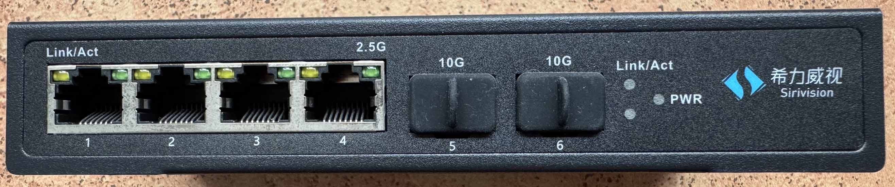
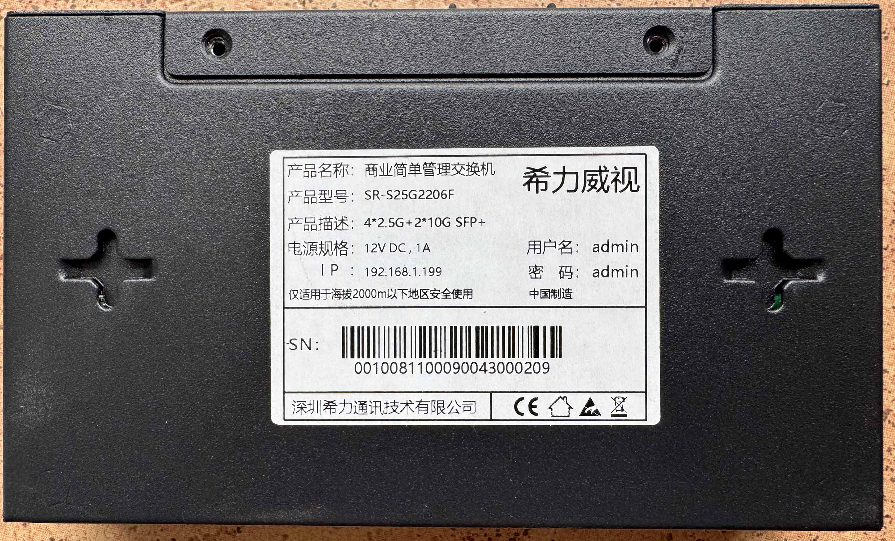
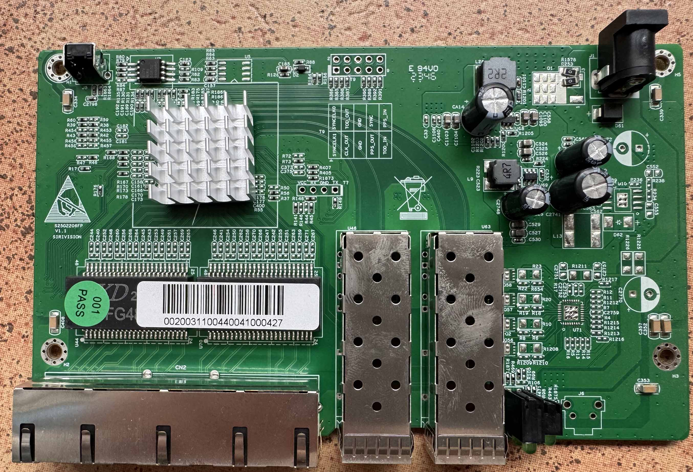
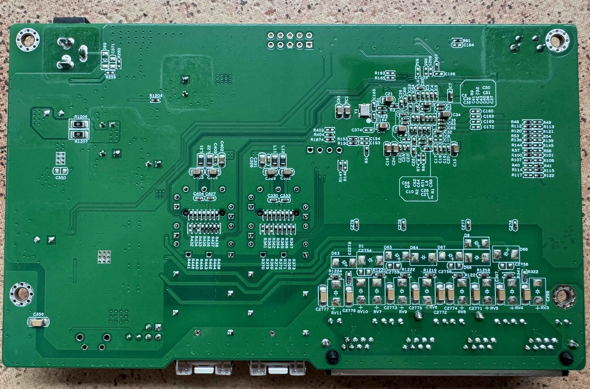
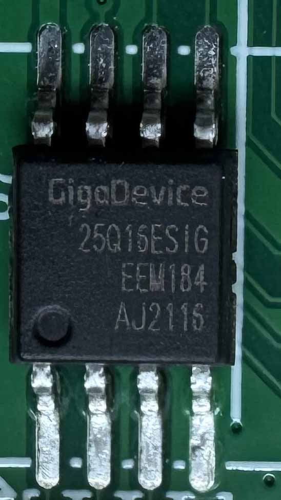

### SIRIVISION_S25G2206FP_V1_1

RTL8372 (non-N) with 4 × 2.5G RJ45 and 2 × SFP+, 2 MB flash. The PCB
silkscreen is `S25G2206FP V1.1`, the `SIRIVISION` vendor mark is printed
separately. It is a web-managed switch, not a full L2+ one: the label calls it
"commercial simple management switch". Two products are known on this board;
they differ only in the RJ45 LED set, see [LEDs](#leds).

## Brands
|Brand|Type|Managed|PCB|Flash|Chip RTL|
|---|---|---|---|---|---|
| YuanLey | YS25-0402M | Yes | SIRIVISION_S25G2206FP_V1_1 | 2M | 8372 |
| Sirivision | SR-S25G2206F | Yes | SIRIVISION_S25G2206FP_V1_1 | 2M | 8372 |

The `FP` in the PCB name belongs to the PoE variant; the SR-S25G2206F is
non-PoE. The YuanLey YS25-0402M was the first verified sample; the Sirivision
unit uses the same base wiring and only changes the RJ45 LED conditions.

### Label specifications

Common to both products:

- **Ports**:
  - 4 × RJ45: 10/100/1000/2500 Mbps
  - 2 × SFP+: 1000 / 2500 / 10000 Mbps
- **Power**: 12V DC, 1A  5525 connector

Sirivision SR-S25G2206F label:

| Item | Value |
|------|-------|
| Product name | "commercial simple management switch" |
| Model | SR-S25G2206F |
| PoE | No |
| Managed | Yes, web UI only (simple management, not full L2+) |
| Stock defaults | IP 192.168.1.199, user `admin`, password `admin` |
| Serial | printed as `SN:`, the MAC address is not printed |

The YuanLey label was not recorded; the port and power ratings are identical.

## CPU, PHY and flash

| Part | Identification |
|------|----------------|
| SoC | RTL8372 (non-N), `regget 4` = `0x83720000` |
| PHY | not recorded (under the heatsink) |
| Flash | GigaDevice 25Q16ESIG (GD25Q16ESIG), 2 MB (Sirivision sample) |
| MAC | read from flash offset `0x1FC000`; if absent or invalid, an internal UUID-derived `06:…` address is used |

The machine definition reads a factory MAC from flash offset `0x1FC000`.
The SR-S25G2206F sample has no usable value there (the bytes are blank or
locally administered), so the firmware derives a stable locally-administered
`06:…` address from the chip UUID and lot number. That internal MAC is what
the console prints at `Setting MAC to:`; the board does not carry its MAC on
the label.

## Build

```
make MACHINE=YUANLEY_YS25_0402M        # YuanLey YS25-0402M
make MACHINE=SIRIVISION_SR_S25G2206F   # Sirivision SR-S25G2206F
```

Both targets share the `machine/pcb/S25G2206FP_V1_1.c` base definition; the
Sirivision one uses `machine/pcb/S25G2206FP_V1_1_SIRIVISION.c`, which only
changes the RJ45 LED set.

## Port mapping

| Front port | ASIC MAC | Interface |
|------------|----------|-----------|
| 1–4 | 4–7 (logical) | RJ45 2.5G |
| 5 | 8 (logical) | SFP+ (SDS1, left cage) |
| 6 | 3 (logical) | SFP+ (SDS0, right cage) |

## Board signals

| Function | GPIO |
|----------|------|
| SFP detect, left cage (J4) | 30, low with a module inserted |
| SFP LOS, left cage | 37, high without light |
| SFP detect, right cage (J2) | 50 |
| SFP LOS, right cage | 51 |
| SFP TX disable | not connected, `GPIO_NA` |
| SFP I2C, left | SDA 39 / SCL 40, `I2CBUS(GPIO39_I2C_SDA4, GPIO40_I2C_SCL3_MDC1)` |
| SFP I2C, right | SDA 41 / SCL 40, `I2CBUS(GPIO41_I2C_SDA3_MDIO1, GPIO40_I2C_SCL3_MDC1)` |
| Reset button | 36 |

## LEDs

Both variants have two LEDs per RJ45 port and one LED set for the SFP
section. The difference is in LED set 0:

- `YUANLEY_YS25_0402M`: function 0 = link/activity (1G/100M/10M), function 2 =
  2.5G link/activity; this is the LED set verified on the YuanLey sample.
- `SIRIVISION_SR_S25G2206F`: function 0 = link/activity at all speeds including
  2.5G, function 2 = 2.5G link only.

On the Sirivision front panel the left RJ45 LED is labelled `Link/Act` and
the right one `2.5G`; the SFP cages are labelled `10G` and the SFP section
has a single `Link/Act` LED plus `PWR`.

## What works

The device is fully supported:

- ALL 2.5GBASE-T RJ45 ports work at 10/100/1000/2500 Mbps
- ALL SFP+ ports support 1G, 2.5G and 10G modules
- LEDs work with the same indiciations as the OEM firmware

Sirivision SR-S25G2206F (verified on this unit):

- port mapping; all four RJ45 ports link at 2.5G with a 2.5G peer (100M also
  comes up), and STP moves each port to forwarding on plug and blocks it on
  unplug
- RJ45 LEDs: at 2.5G the left (yellow) LED flashes with traffic and the right
  (green) LED stays on; at 100M the left LED still flashes and the right one
  is off
- both SFP+ cages with a Finisar FCBG110SD1C05-1RA 10G AOC: module detected,
  DOM read over I2C, link up, hot plug/unplug handled
- a 1G copper module (ETU ESB3 512-3SCD20) in the right cage: detected,
  SDS switched to 1G and link up at 1G
- reset button on GPIO36: a short press is reported on the console
  (`Short button press detected; no action.`); a 3–10 s press restarts the chip
  (`>3s button detected; resetting chip...`)
- the configuration (VLANs, management VLAN, port names) survives that restart
- web upgrade from an older RTLPlayground build
- internal MAC: no MAC on the label, a stable `06:…` address derived from the
  chip UUID, unchanged across restarts

## Unverified

- 2.5G SFP modules on the Sirivision unit (1G and 10G modules were tested)

## Hardware overview

Front



Label



### PCB overview

**Board markings**
- Top silkscreen: SIRIVISION S25G2206FP V1.1

Top side


Sirivision top side



Bottom



Flash chip, GigaDevice 25Q16ESIG



## Power supply

Input power is delivered via barell plug, `12V 1A` adapter was provided.

## Related

- `machine/pcb/S25G2206FP_V1_1.c` — YuanLey YS25-0402M / PCB baseline
- `machine/pcb/S25G2206FP_V1_1_SIRIVISION.c` — Sirivision SR-S25G2206F LED variant
- `machine/YUANLEY_YS25_0402M.c` / `machine/SIRIVISION_SR_S25G2206F.c` — symlinks to the definitions above
- [`doc/supported_devices.md`](../supported_devices.md)
